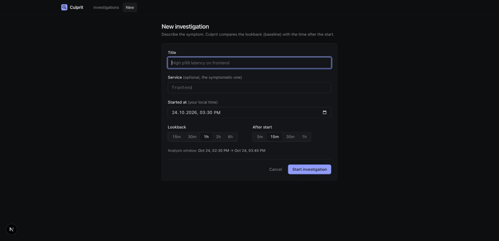

# Culprit

**An open-source AI incident investigator.** When production breaks, Culprit reads your metrics, logs and recent changes, runs deterministic analysis first, then lets an LLM agent dig deeper. You get a ranked root-cause report in which every claim links to the evidence behind it.

Culprit is read-only. It queries your systems and never changes them.



*A live run against the [demo stack](demo/README.md): a catalog deploy adds an N+1 query, the alert fires on frontend, and Culprit names the deploy in 14 seconds while ruling out a feature flag that was rolled out shortly before.*

**The 40-second overview:**

https://github.com/user-attachments/assets/3ad3575d-2e1e-47b3-9d36-7844210e45eb

```
alert / CLI / UI
      │
      ▼
┌─ triage (no LLM) ─────────────────────────────────────────┐
│ anomaly onsets · log pattern shifts · change correlation  │
│ suspect services from onset order + topology              │
└──────────────┬────────────────────────────────────────────┘
               ▼
┌─ agent ───────────────────────────────────────────────────┐
│ LLM calls read-only tools: get_metric, search_logs,       │
│ log_patterns, list_changes, get_change, get_topology      │
│ every result → evidence ledger (E1, E2, ...)              │
└──────────────┬────────────────────────────────────────────┘
               ▼
 validated report: ranked hypotheses, each citing evidence IDs
```

## Why

Most of the first hour of an incident goes on the same questions. What changed? Which service broke first? Is this error new? Culprit answers those in seconds with plain statistics, then uses an LLM only where judgement is needed. That keeps it fast and cheap, and its conclusions can be checked.

- **Deterministic first.** Robust change-point detection finds when each metric actually started moving, which is often well before the alert. Drain-style log template mining shows which error patterns are new. Changes are ranked by timing, service and topology.
- **Evidence or it didn't happen.** The agent must cite ledger evidence for every hypothesis. A report that cites unknown evidence is rejected and repaired before you see it.
- **Any model.** It works with any OpenAI-compatible endpoint: OpenAI, OpenRouter, [Switchyard](https://github.com/shadatr/switchyard), Ollama or vLLM.
- **Budgets.** Every investigation has step, time and token limits.
- **Measured.** It ships with an evaluation harness and incident scenarios with known root causes (see [EVAL.md](EVAL.md)).

## Results so far

On 8 held-out incident scenarios (written after tuning, never tuned against), using `claude-haiku-5.5`:

| | Triage only (no LLM) | Full investigation |
|---|---|---|
| Root-cause service ranked first | 2/8 | **6/8** |
| In top 3 | 6/8 | 7/8 |
| Reports with valid evidence citations | n/a | 8/8 |
| Mean time / tokens | ~0.1 s / 0 | 16 s / 27k |

See [EVAL.md](EVAL.md) for the method, dev-set numbers and the misses, and [docs/example-report.md](docs/example-report.md) for a full report.

## Quick start

```bash
make build

# 1. No LLM, no setup: deterministic triage over a bundled scenario
./bin/culprit investigate -scenario eval/scenarios/catalog-bad-deploy -triage-only

# 2. Full investigation (any OpenAI-compatible endpoint)
export CULPRIT_LLM_API_KEY=...
./bin/culprit investigate -scenario eval/scenarios/catalog-bad-deploy

# 3. Against your own stack
cp culprit.example.yaml culprit.yaml   # point at Prometheus, Loki, git repos, deploy log
./bin/culprit investigate -config culprit.yaml -title "High p99 on checkout" -service checkout -since 1h
```

### Web UI and webhooks

```bash
./bin/culprit serve -config culprit.yaml          # API on :8090
cd web && npm install && npm run dev               # UI on :3200
# Mock mode, no backend needed:
NEXT_PUBLIC_CULPRIT_MOCK=1 npm run dev
```

To investigate alerts automatically, point Alertmanager at `POST /api/webhooks/alertmanager`. Each firing alert becomes an investigation, with duplicates of the same alert skipped for 30 minutes.

### Demo environment

`demo/` contains a small shop (frontend, catalog, cart, Postgres, Redis) with Prometheus, Loki and a fault injector. See [demo/README.md](demo/README.md).

## Data sources

| Source | What Culprit reads |
|---|---|
| Prometheus | metric selectors (recording rules recommended, see `culprit.example.yaml`) |
| Loki | logs by service label, filtered by text and level |
| Git | commits from local repositories, mapped to services |
| Changes file | deploys, config changes and feature flags as JSON lines |
| Fixtures | offline scenario directories for tests, evals and demos |

Planned: traces (Tempo/Jaeger), Kubernetes events, the GitHub deployments API, and Slack summaries.

## Development

```bash
make test        # go test -race ./...
make lint        # gofmt + go vet
make scenarios   # regenerate eval scenarios (deterministic)
make eval        # run the evaluation (needs an LLM key)
```

The architecture, contracts and workstreams are documented in [PLAN.md](PLAN.md).

## License

MIT
